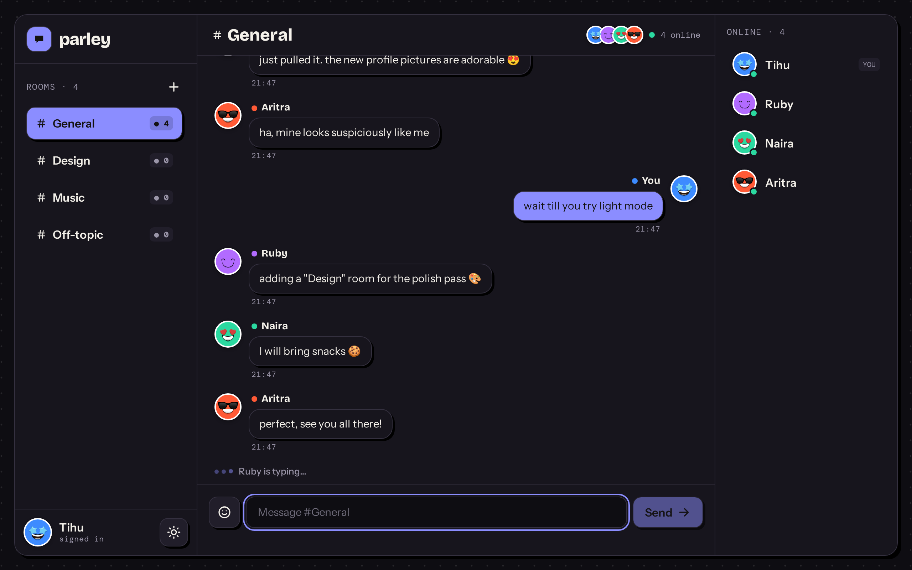
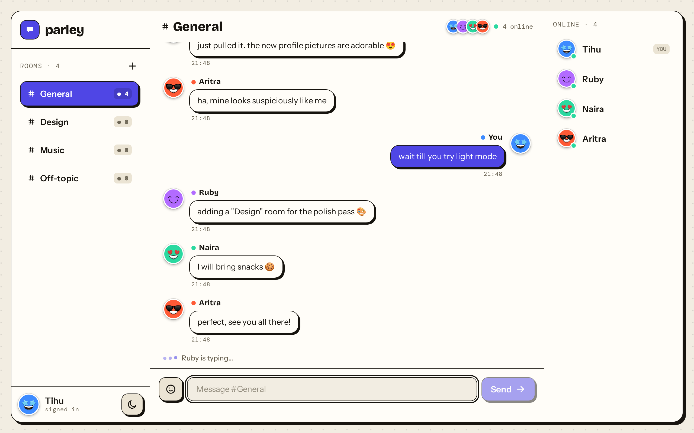
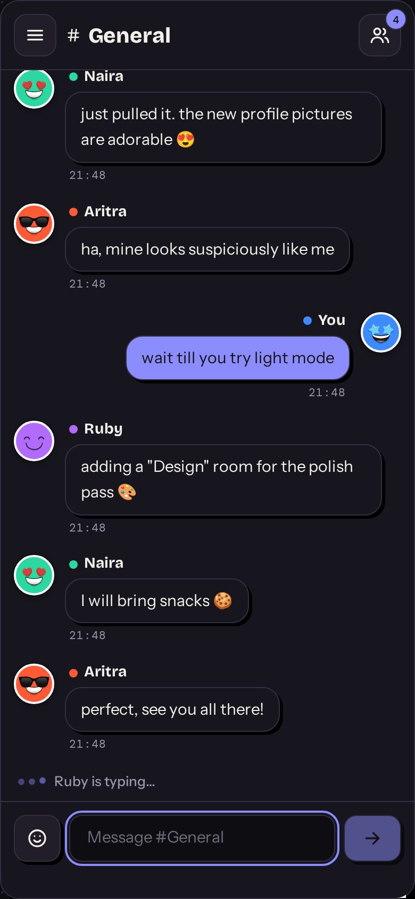
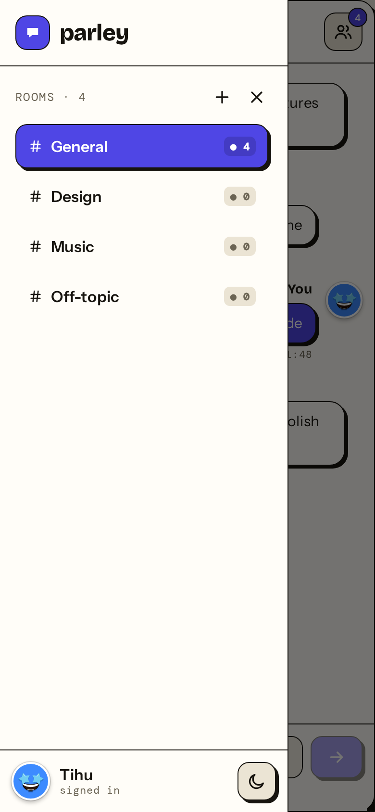

# parley — real-time chat

Full-stack multi-user chat: **React (Vite) + Tailwind** client, **Node + Express + Socket.IO** server, **SQLite** (better-sqlite3) storage.
No accounts or passwords: pick a display name, a colour and a picture, jump into a room.



| Light | Mobile (390px) | Mobile drawer |
|---|---|---|
|  |  |  |

Demo recording: [`docs/chat-demo.webm`](docs/chat-demo.webm). More shots in `docs/screenshots/`.

## Setup & run

Requires Node 20+.

```bash
npm install
npm run dev
```

`npm run dev` picks free ports (preferring 5180 for the client and 5181 for the server) and prints the URLs, e.g.

```
➜ App (open this):  http://localhost:5180
➜ API + sockets:    http://localhost:5181
```

Open the app URL in two browser windows (use different names) to chat with yourself. The demo recording/screenshots use Tihu, Ruby, Naira and Aritra.

| Command | What it does |
|---|---|
| `npm test` | server unit tests (node:test) + Playwright two-user e2e |
| `npm run test:server` / `npm run test:e2e` | run just one half |
| `npm run build && npm start -w server` | production: server serves `client/dist` on `SERVER_PORT` (5181) |
| `npm run media` | regenerates screenshots and the demo video in `docs/` (needs `ffmpeg`) |

First e2e run may need browsers: `npx playwright install chromium`.
Env: `CLIENT_PORT`, `SERVER_PORT`, `DB_PATH` (default `server/data/chat.db`, gitignored).

## Features

- Join with a display name (2–24 chars, unique among online users), an avatar colour and a sticker avatar (24 offline DiceBear "fun-emoji" stickers on your colour; the id is validated server-side and shown to everyone; unknown/old ids fall back to a sticker, never a broken image)
- Rooms: default **General**, create your own (max 30), live online counts per room
- Persisted messages per room (SQLite), last 50 sent on join, 1000-char limit, timestamps
- Live online-users list per room, join/leave system messages
- Typing indicator (debounced client-side, auto-clears server-side)
- Grouped message bubbles (own vs others), sticker avatars on each user's colour (initials only as alt text)
- Emoji picker (built-in set); Enter sends, Shift+Enter inserts a newline
- Auto-scroll with a "N new messages" pill when scrolled up
- Blue-violet accent (periwinkle in dark, indigo in light); dark / light theme, remembered in localStorage
- Responsive: below 1024px both sidebars become drawers
- Connecting, disconnected (banner + automatic re-join) and empty-room states
- Safety: server-side validation/trimming, per-socket rate limit (6 msgs / 5 s), messages rendered only as React text (never HTML)

## Layout

```
server/  src/{validation,rateLimit,db,chat,index}.js   test/*.test.js
client/  src/{App.jsx,useChat.js}  src/components/*
tests/   chat.spec.js   (Playwright: two browser contexts)
scripts/ dev.js (runs both), media.mjs (screenshots + video)
```

## Licences

Sticker avatar art: DiceBear "Fun Emoji" (`@dicebear/collection`), by Davis Uche, licensed [CC BY 4.0](https://creativecommons.org/licenses/by/4.0/) — https://www.dicebear.com/styles/fun-emoji/. Generated locally at runtime from the bundled package (no network, no extra assets); the sticker outline/shadow is our own CSS.
